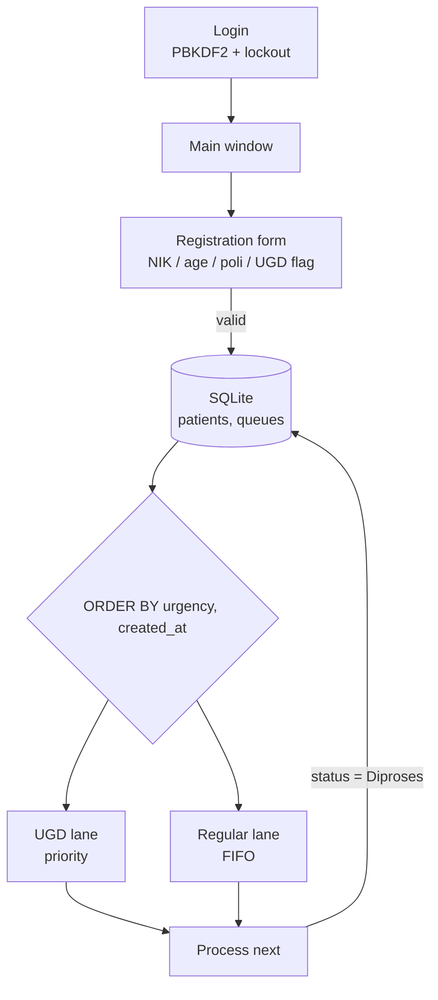
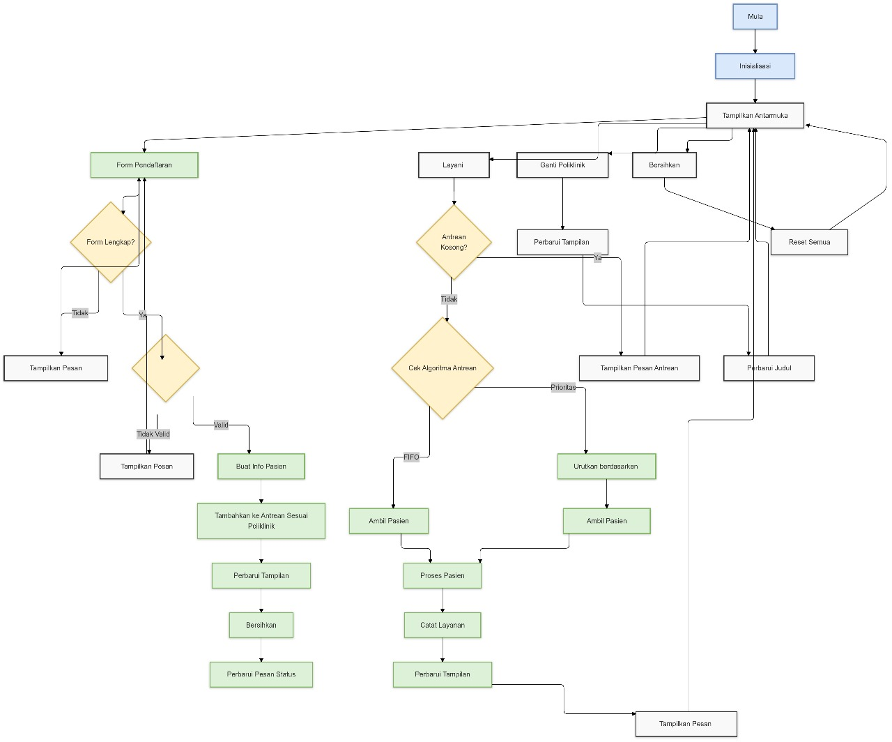

<h1 align="center">Antrian RS</h1>
<p align="center">A Tkinter hospital queue manager that serves emergency (UGD) patients ahead of regular ones, backed by SQLite.</p>
<p align="center">


</p>

## Overview

Final project for a Data Structures and Algorithms course. A plain first-come-first-served line is unfair to an emergency case that arrives after ten routine ones, so the app keeps two queues side by side: a priority lane for UGD (emergency) patients and a FIFO lane for regular patients. The "next patient" action always drains the priority lane first and falls back to arrival order.

The repository also keeps `docs/flowchart.jpg`, the design flowchart drawn for an earlier prototype that had a FIFO / priority selector. The final app in `app.py` replaced that selector with the two-lane layout and added the database and login layers.

## Features

- Patient registration with NIK validation (exactly 16 digits, also enforced by a SQLite `CHECK` constraint), age range 0-120 and unique NIK.
- Emergency flag ("Prioritas UGD") that routes the patient to the priority lane.
- Two live, color-coded queues (red for UGD, blue for regular); cards show queue number, poli, status and waiting minutes, and refresh every 30 seconds.
- Queue numbers per type and poli, such as `REG-UMU0001` / `UGD-JAN0001`.
- "Process next" picks `ORDER BY UGD first, then created_at`; a per-card "Proses" button handles a specific entry.
- SQLite layer with a `schema_version` table and two migrations, foreign keys, indexes, and transactional registration.
- Login with PBKDF2-HMAC-SHA256 (100,000 iterations, random 32-byte salt), lockout for 15 minutes after 3 failed attempts, and a 30-minute session timeout.

## How it works



## Screenshots

| Design flowchart (earlier prototype) |
| --- |
|  |

## Getting started

Requires Python 3 with Tkinter (bundled with the standard Windows/macOS installers). No third-party packages.

```bash
python seed_demo.py   # optional: inserts four fictional patients (NIK 000000000000000x)
python app.py
```

`hospital.db` and `hospital.log` are created in the current directory on first run. On first start the app creates a demo account, `admin` / `admin123`; this is a hard-coded course-project default and must be changed before any real use.

The database layer and the queue-number logic were exercised headlessly; the Tkinter window itself was not launched while preparing this repository.

## Project context

Individual project for the Data Structures and Algorithms course, Computer Engineering, UPI Kampus Cibiru, 2024.

## Limitations

- The ordering is done in SQL (`ORDER BY`), not with an explicit in-memory FIFO queue and heap; a side-by-side FIFO vs priority toggle only existed in the earlier prototype.
- "Proses" moves an entry to `Diproses` and nothing moves it to `Selesai`, so processed entries stay visible (with a disabled button) until the status is changed in the database.
- Session expiry is only checked on the 30-second refresh; there is no role-based screen separation beyond the single admin role.
- No automated tests.

## License

MIT
